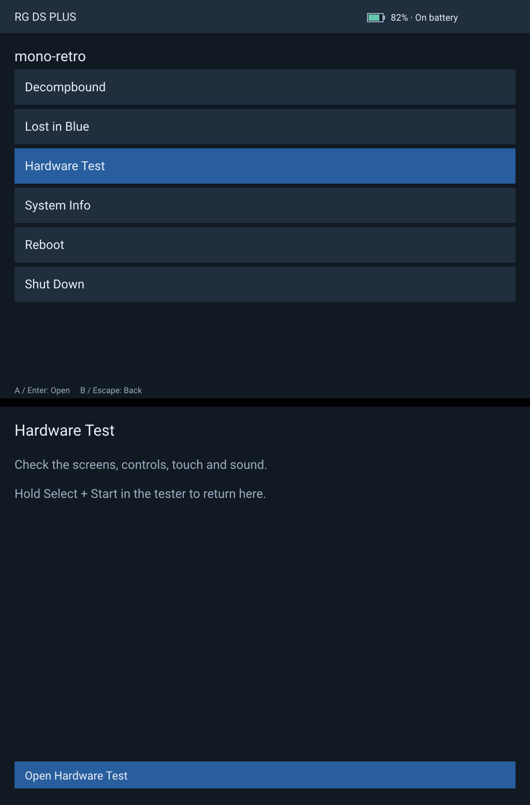
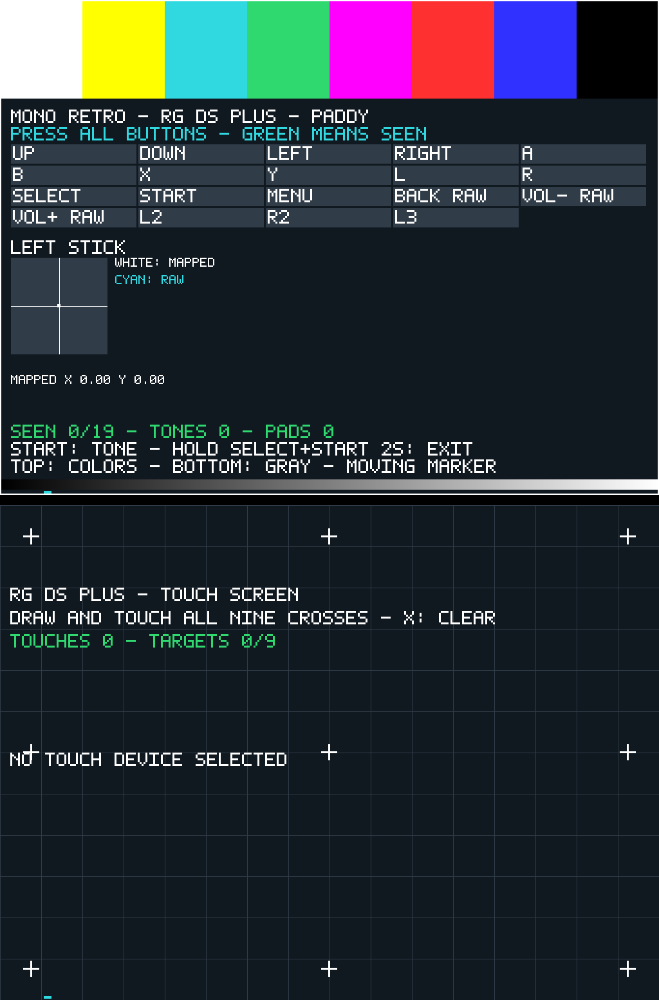

# mono-retro

A launcher, hardware tester and libretro player written in Nim for Linux
handhelds and desktops. Developed on Gentoo with the Anbernic RG SP and
RG DS Plus, with X11 support for desktop development and play.

<table>
  <tr><th>RG DS Plus menu</th><th>DS hardware tester</th></tr>
  <tr>
    <td></td>
    <td></td>
  </tr>
</table>

RG DS Plus layout previews, with both screens stacked in each image.

- **Launcher:** open games and the hardware tester, view system and battery
  information, reboot or shut down.
- **Player:** run libretro cores with integer scaling, audio, controller input,
  save files and state imports.
- **Hardware tester:** check displays, buttons, sticks, multitouch and sound;
  inspect raw input and calibrate device profiles.

Tested cores include mGBA, [melonDS DS](https://github.com/JesseTG/melonds-ds) and
[Decompbound](https://github.com/monofuel/decompbound). Bring your own cores.

## Dual-screen play

- **Nintendo DS on two physical displays:** melonDS DS can output its top and
  bottom screens to separate DRM/KMS displays, with touch input on the bottom
  screen. Tested on the RG DS Plus. On desktop, use one combined window or two
  separate windows with mouse input for touch.
- **Experimental SNES-DS mod support:** Decompbound's EarthBound DS companion
  puts the game on one screen and live party stats and inventory on the other.
  Touch selects a party member. See the [companion guide](README-player.md#earthbound-ds-companion).

## Nim libraries

mono-retro builds on Treeform and Guzba's libraries:

| Library | Used for |
| --- | --- |
| [Windy](https://github.com/treeform/windy) | X11 windows, framebuffer and DRM/KMS displays, multitouch and GPU presentation. |
| [Paddy](https://github.com/treeform/paddy) | Gamepad discovery and input. |
| [Pixie](https://github.com/treeform/pixie) | Images, text and UI drawing. |
| [Slappy](https://github.com/treeform/slappy) | Player audio through OpenAL. |
| [NimSIMD](https://github.com/guzba/nimsimd) | ARM NEON pixel conversion. |
| [Nimby](https://github.com/treeform/nimby) | Dependency management. |

The [lock file](nimby.lock) pins public revisions of the
[Windy](https://github.com/monofuel/windy/tree/monofuel/drm-gpu-player) and
[Paddy](https://github.com/monofuel/paddy/tree/anbernic-handhelds) forks that
provide the Linux handheld backends. Device-specific mappings live in mono-retro.

For related Nim graphics work, see [Shady](https://github.com/treeform/shady),
a Nim-to-shader compiler. It is not currently a mono-retro dependency.

## Platforms

| Platform | Display and input |
| --- | --- |
| Linux desktop | X11, keyboard, mouse and gamepad. |
| Anbernic RG SP | Framebuffer display and handheld controls. |
| Anbernic RG DS Plus | Two DRM/KMS displays, handheld controls and bottom-screen multitouch. Panfrost GPU presentation is supported on the source-built kernel. |

## Build

Use **Nimby 0.2.3 or newer**, Nim 2.x (tested with 2.2.4), a C compiler and
Make. Start in a new workspace so dependency synchronization does not move
checkouts used by another project:

```sh
mkdir mono-retro-workspace
cd mono-retro-workspace
nimby create

git clone https://github.com/monofuel/mono-retro.git
cd mono-retro
nimby sync nimby.lock
```

Desktop builds need libudev, libevdev, libX11, libXcursor, OpenAL Soft and
OpenSSL. The tester also uses ALSA for its tone. On NixOS, enter
`nix-shell shell-player.nix` before building.

```sh
make launcher-desktop player-desktop
```

Outputs are `build/mono-retro`, `build/mono-retro-hwtest` and
`build/mono-retro-player`. The launcher opens with `build/mono-retro`;
[the player guide](README-player.md#build-and-run) shows how to select a core
and ROM. See [Windy builds](README-windy.md) for cross compilation and native
handheld backends.

Optimized shipping builds are the default. Use `-d:debug` for compiler runtime
checks and stack traces. Run the local checks and tests with:

```sh
make check test test-player
```

## Guides

- [Player](README-player.md): cores, controls, saves, state imports and DS layouts.
- [Launcher](docs/launcher.md): navigation, battery status and handheld installation.
- [Hardware test](docs/hardware-test.md): display, input, sound and calibration.
- [Windy backends](README-windy.md): X11, framebuffer, DRM and cross builds.
- [RetroAchievements](docs/retroachievements.md): Casual mode for Decompbound.
- [Performance](docs/player-performance.md): measurements and planned improvements.
- [Libretro extension](docs/libretro-extensions.md): optional native pixel formats.

Gentoo images and device setup live in monobake and monorig. Kernel packages
live in [mono-overlay](https://github.com/monofuel/mono-overlay).

## License

Original code and documentation use [MIT](LICENSE). Third-party files retain
their own licenses: [Roboto](assets/README.md), [libretro.h](third_party/README.md)
and [rcheevos](third_party/rcheevos/README.md). Emulator cores retain their own licenses.
