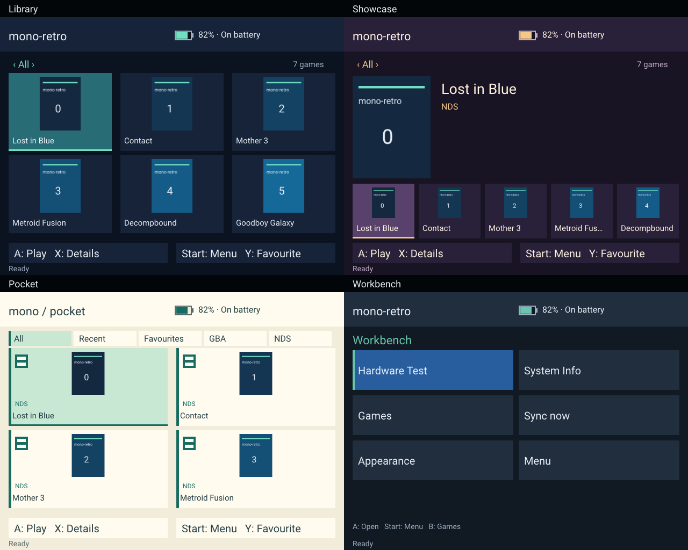

# Menu themes

Open **Menu → Appearance** to try another style. Use the D-pad, arrows or
shoulder buttons to browse previews; touch or click a style name to select it.
**A / Enter / Apply** saves your choice. **B / Escape / Cancel** leaves the
current style unchanged.



| Style | Home screen | On two screens |
| --- | --- | --- |
| Library | Cover grid with filters. | Game details above, touch library below. |
| Showcase | Selected-game artwork and a strip of neighboring covers. | Artwork and details above, browsing below. |
| Pocket | Bright cards, cartridge icons and selectable filter tabs. | Details above, touch cards and tabs below. |
| Workbench | Large buttons for Hardware Test, System Info, Games and sync tools. | Device status above, tools below. |

The preview uses your current library. It cannot launch anything or change a
save. Applying a style keeps the selected game, filter, favourites and any
running sync operation. Workbench opens its dashboard; its Games button returns
to the same library. Every style includes the Menu and Appearance options.

Library is the default until you apply another style. The choice lives in
`$XDG_CONFIG_HOME/mono-retro/menu.json`, or `~/.config/mono-retro/menu.json` when
that variable is unset, under the user running the launcher. It stays on the
OS card when the games card moves between devices. This file is separate from
library configuration and RomM credentials.

For a temporary comparison on a desktop or handheld:

```sh
build/mono-retro --library:/path/to/games --config:/path/to/library.json --theme:showcase
```

The override does not rewrite preferences. Choosing Apply still saves the
previewed style. The standalone diagnostic launcher without `--library` retains
its original interface and command-line overrides.

## Developing a style

Themes are compiled Nim code using the existing Windy, Pixie and Paddy stack.
Their layout supplies the geometry used for drawing, pointer targets and
controller navigation. Shared application actions own game launching, RomM,
saves, hardware handoff and power confirmations; a style changes their
presentation rather than reimplementing those operations.

Artwork is cached with bounded dimensions and entry count. Selection uses a
short transition; an idle menu does not animate continuously. The RG SP uses
the same rendering path as the other themes without needing GPU-only effects.

`tests/test_libraryview.nim` produces single-screen, paired-screen and gallery
previews in `build/` using synthetic covers. It checks layouts and input targets
at small desktop and handheld sizes. The isolated X11 integration test also
switches styles, exercises Apply/cancel and launches a fixture player after each
switch. No game or audio is required for these tests.

Further ideas, including motion, richer artwork and additional customization,
remain in [the styling brainstorm](menu-styling.md).
